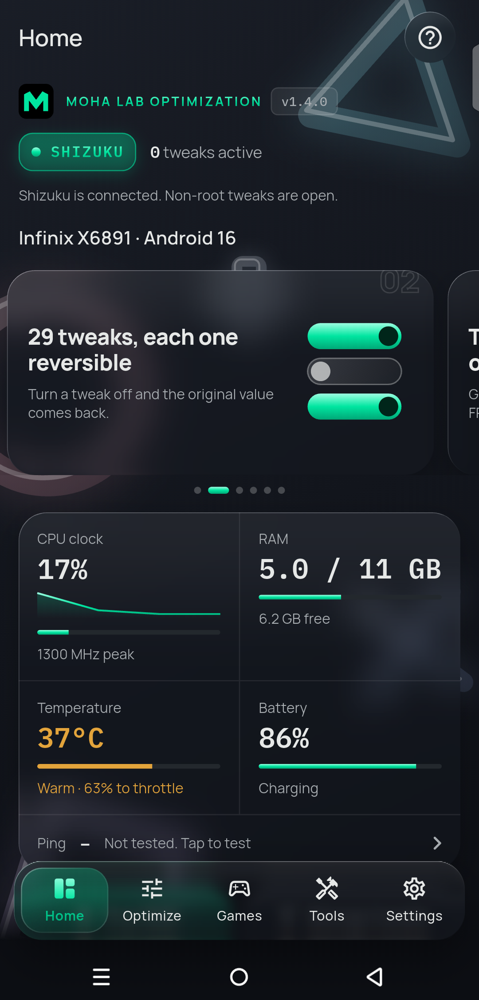
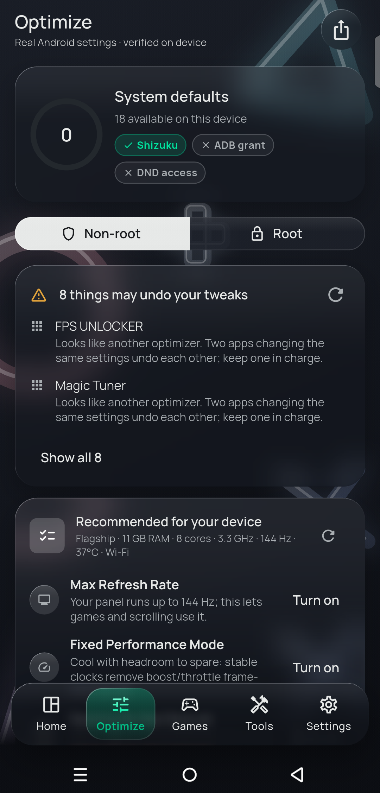
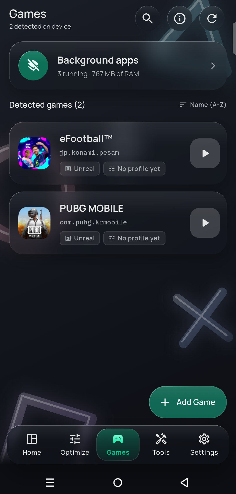
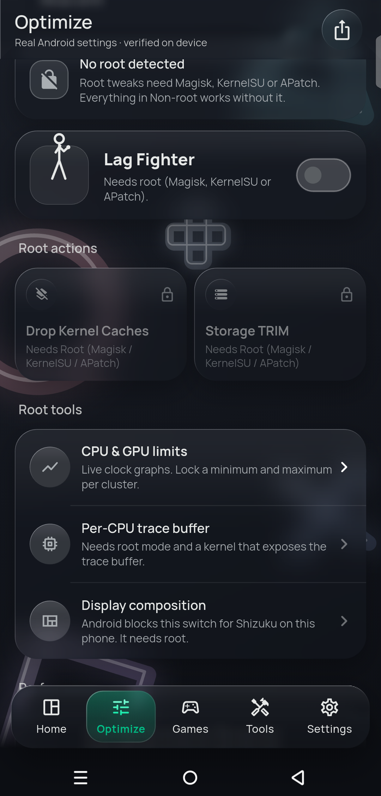
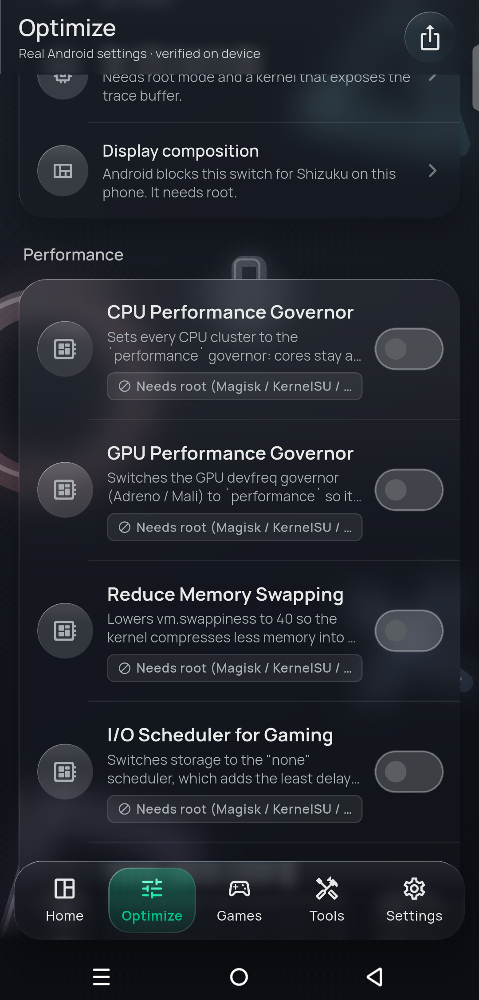
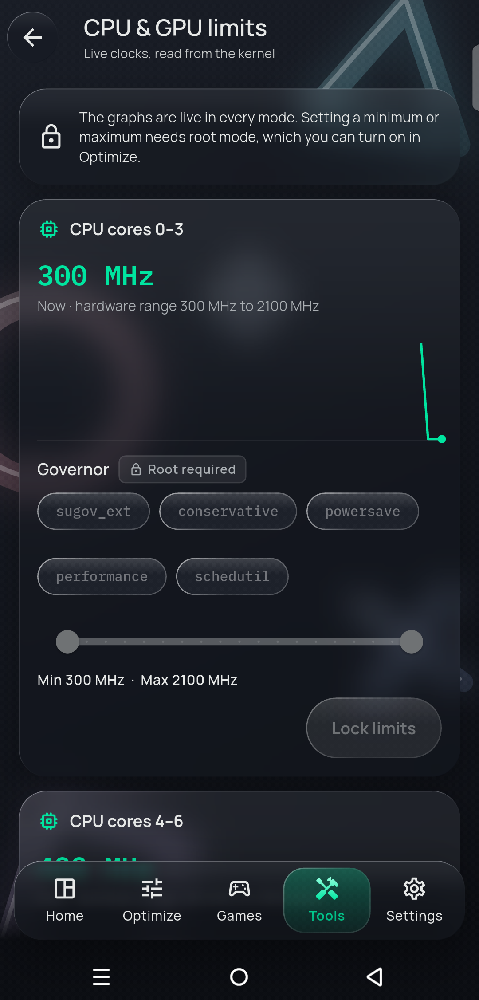

# Changelog

Download the latest signed APK from [Releases](../../releases/latest).
Any APK from another source is unofficial.

## v1.7.0 — November 15, 2026

### Moha Lab in your language
Moha Lab now speaks English, Indonesian, Portuguese (Brazil), Filipino, Arabic, Hindi, Malay, Bengali and Vietnamese. You choose one on the first screen, also after this update, and can change it any time in Settings. MohaLab Boost and notifications follow it, and Arabic reads right to left.

### New
- **Force Peak Refresh Rate:** keeps the screen at its highest refresh rate in every app, also on still screens, with or without root. The card shows the rate the screen really runs at. On Infinix, Tecno and itel (XOS), the system picks the rate for each app and keeps its top rate (for example 144 Hz) for its own game mode, so without root the app can't always reach it, and it tells you so. With root, Moha Lab sets the top rate directly; this is not yet tested on many rooted phones.
- **New tweaks:**
  - **Turn Off Logging:** the "Logger buffer sizes: Off" developer option.
  - **Background App Limit:** keeps at most 4, 8, 16 or 32 background apps. With a low limit, switching from a game to another app can close the game.
  - **Smallest Width:** 330, 350 or 380 dp.
  - **Turn Off Touch Indicators:** switches off "Show taps" and "Pointer location".
  - **Game Edge Guard:** sets the back gesture to its lowest sensitivity, so swipes near the edge stay in the game.
  - Each one is read back from the phone and put back when you turn it off.
- **Faster Touch & Hold:** any time from 50 to 1000 ms on a slider. Warning, Gaming, Recommended and Relaxed zones show what each time means. Below 150 ms a normal tap in apps can open a long-press menu; games are not affected.
- **Storage TRIM** now works with Shizuku too, not only root, and checks with Android that the trim really ran.
- **Gyro check** in Tools: shows how many milliseconds pass between gyroscope readings and the longest wait. It also explains what really makes gyro aim feel late: low FPS, heat and the game's own gyro settings. No app can make the gyroscope itself faster.
- **Boost:**
  - The water wave is replaced by a 10-second fight scene with its own sound: a ninja beats the Lag monster. Then it shows what was really cleaned. It never blocks your touches.
  - Drag the FPS handle anywhere on the screen. From the panel you can switch the FPS number off and on.
- **Import a backup** by choosing the file. Pasting the text also works, in a new sheet that stays above the keyboard.

### Fixed and improved
- **FPS meter:**
  - It now works in PUBG and other games on phones that block the quick frame counter. Before, it showed "–".
  - It no longer shows 240 FPS on some phones; it never goes above the screen's rate.
- **Boost panel:** it no longer blurs the game behind it, and it reads the FPS with less work, so it uses less battery and CPU.
- **Smoother scrolling:** lighter glass on Android 9, low-RAM phones and phones under 4 GB, and a Smoother scrolling switch in Settings.
- **Light theme:** the glass is clearer, with a real glass edge.
- **Problem reports:** when the app crashes or a tweak fails to turn on, it can send a short report, so problems on tablets and other phones can be found and fixed.

### Privacy
To fix problems on phones the developer doesn't have, Moha Lab now also sends:
- your phone's chip name and the app language
- short reports when the app crashes or a feature fails to turn on

No name, account or phone number is attached. Details are in the [privacy policy](https://github.com/7Mohan/mohalaboptimazation/blob/main/store/privacy-policy.md).

## v1.6.0 — October 31, 2026

**Updated October 31:** fixes MohaLab Net Flash not turning on from the Boost panel when the VPN permission was missing. The panel now asks for the permission. If you installed v1.6.0 earlier today, download it again and install over it; your settings stay.

### MohaLab Net Flash
Choose which apps lose internet while you play, like a firewall. Turn it on in Tools, from the Boost panel, or in every game. The game itself stays online, and you can change the list during a game, so an app you are waiting for a call in can stay connected.

It uses Android's VPN permission: the chosen apps' data is dropped on your phone and nothing is sent anywhere. It stops those apps using your connection; it can't make your internet or a game server faster. Android allows one VPN at a time.

### New
- **Debloat cleaner** in Tools: search, select some or all apps, and remove them together. Apps you installed are uninstalled. Pre-installed apps are removed for your user and can be restored; without root their file stays on the phone. Removing an app deletes its data. Needs Shizuku or root.
- **Clean when a game opens:** Boost clears app caches and cached background apps, then shows what it measured. Apps rebuild their caches later. You can turn this off on the Boost screen.
- **Compile this game** in the Boost panel: compiles the game's app code ahead of time and checks the result on the phone. It works from the next time you open the game. The engine in many big games is already compiled, so you may see little or no FPS change.
- **Memory Lab:** separate Clear cache and Force stop, and a list of apps to never force stop.
- **Touch & Hold:** choose the delay.
- **Sensor test** in Tools: measures your sensors' rate and noise.
- **Smart trigger** can look for its picture anywhere on the screen. Some online games treat automatic taps as cheating, so check the game's rules first.
- Animations and sounds for Net Flash, Smart trigger, Compile and the game-start clean, and a new welcome after the opening logo. Sound effects stay silent during calls.

### Fixed and improved
- Boost comes back by itself after you clear Moha Lab from recent apps or update it. It can take about 30 seconds. On phones that use Shizuku through ADB, start Shizuku again after a restart.
- FPS meter: steadier, no blinking, updates every second.
- Apps in a small window no longer throw you out of the game on phones without small windows; you get a message. This needs Android's small windows, which some phones, including Infinix, don't offer to other apps.

### Privacy
To improve the app, Moha Lab now also collects your phone's maker and model, Android version and country, and an online signal while the app is open. An anonymous ID keeps one phone counted as one user after a reinstall. No name, account or phone number is attached. Details in the [privacy policy](https://github.com/7Mohan/mohalaboptimazation/blob/main/store/privacy-policy.md).

## v1.5.0 — October 19, 2026

### MohaLab Boost
A game panel over your games. Turn it on in Games, choose your games, and a small FPS handle appears at the screen edge while you play. Tap it to open the panel. Everything the panel switches on is undone when you leave the game.

- **Basic:** live FPS, CPU and GPU gauges, battery temperature and RAM. Power saving, Balanced and Performance modes. Screenshot, screen recording, screen search, memory cleanup and a brightness slider. Up to five apps that open in a small window over the game.
- **Quick access:** Esports mode (performance mode, Do Not Disturb, no pop-ups and a locked notification bar in one switch), Eye care, Off-screen gaming (the picture goes black, the game keeps running; double-tap to come back).
- **Smart trigger:** save a part of the screen, like a button or a pop-up, and choose up to two taps. When it appears there again, Moha Lab taps for you. Some online games treat automatic taps as cheating, so check the game's rules first.
- **Network enhancement:** low-latency Wi-Fi, mobile data on standby beside Wi-Fi, and a ping test.
- **Anti-interference:** Call rejection, Do Not Disturb, hide notification pop-ups, block the drag-down notification bar.
- **Gameplay add-ons:** game filters (grayscale, inverted colours).
- **Infinix, Tecno and itel (XOS):** image stabilization, touch optimization, bypass charging, call on hold, stay online during calls and mistouch prevention for navigation gestures, using the phone's own switches. They only show on phones that have them.

Most Boost tools need Shizuku or root. Without it the panel still opens and says what is missing.

### New
- **Custom resolution** in Tools: pick how many pixels the phone renders. It goes back by itself unless you tap Keep.
- **Touch test** in Tools: find dead spots, check multi-touch and catch ghost touches.
- **New tweaks without root:** Keep Games Alive in the Background (Android 12L and newer) and Stay Awake While Charging.
- **New root tweak:** turn off ZRAM and swap. Refused when free RAM is too low.
- **Messages from Moha Lab:** a bell on Home with every message, notifications in your notification bar, and a notice when an update is needed.
- **First start** explains every permission before asking for it.

### Fixed and improved
- Reset Everything now turns every tweak off and puts your phone back before deleting any data.
- Unreadable buttons in the light theme on CPU & GPU limits.
- If a feature or tweak causes problems, Moha Lab can pause it for everyone until it is fixed, without a new update. A paused tweak that was on is turned off and your setting put back.

### Privacy
The app now sends its version, a random install ID and the names of the Moha Lab tweaks and features you have on, so we can see what is used and pause something that causes problems. Nothing about you is sent. Details in the [privacy policy](store/privacy-policy.md).

## v1.4.0 — October 4, 2026

### New look
- **Liquid glass on every screen:** panels, buttons, bars, sheets and dialogs bend what is behind them, with a lit edge. Green actions and "on" states are green glass.
- **Calm dark theme by default,** and a light theme in Settings.
- **New logo and app icon:** the green Moha Lab M on black, with the logo and your version at the top of Home.
- **Home banners** that show how Moha Lab works. Swipe them or let them move on; the last one links to the community.
- **New opening sound,** and a glass press when you tap.
- **New layout:** Home, Optimize, Games, Tools and Settings; the labs now live in Tools.

### New
- **FPS cap that works on more phones:** where Android ignores its per-game frame-rate limit, Moha Lab caps the screen refresh rate while the game runs and puts it back when you leave (start the game from Moha Lab).
- **Ultra Cleaner (Shizuku):** app caches, shared-storage caches and thumbnail caches, with the space really freed. Your own files are only removed when you tick them; root adds system logs.
- **Performance check:** finds what slows your phone, why, and what to do.
- **ANGLE on Vulkan tweak,** and Device Lab shows your GPU, OpenGL ES and Vulkan versions.
- **Memory Lab, CPU cores graph, Background apps** in Games, and per-game graphics driver and priority.

### Root (Magisk, KernelSU, APatch)

- **Lag Fighter:** cuts micro-stutter. The CPU speeds up the moment a frame needs it, and the game on screen always gets priority over background work.
- **CPU and GPU governor choice:** pick from the governors your kernel lists, next to the live clock graphs and minimum / maximum locks in CPU & GPU limits.
- **I/O Scheduler for Gaming:** switches storage to the scheduler with the least delay.
- **Faster Game Loading:** raises storage read-ahead to 512 KB, so large game files load in fewer, bigger reads.
- **Per-CPU trace buffer** setting, and **Ultra Cleaner** also clears crash reports and system logs with root.
- Root-only tweaks and recommendations now live in their own Root view.
- Every kernel value is saved before the first change and put back when you turn the tweak off.

Root features are new; if one does not work on your phone, tell us in the community.

### Improved
- Game Mode, render resolution and FPS can be set independently, and the app tells you when to reopen the game to apply them.
- Games show which graphics driver was really used, and only offer drivers that can load on your phone.
- ANGLE on Vulkan opens Developer options, the only place Android lets you switch it.
- Max Refresh Rate tells you honestly when your phone keeps a 60 Hz floor.

### Fixed
- Tabs that needed two taps.
- Free cached apps on phones with dual apps.
- Unreadable governor buttons in dark mode.
- Sheets that would not scroll and buttons hidden behind the tab bar.

No ads in this version.

### Verify your download
The official APK is signed with this certificate (SHA-256):

`C0:E2:5B:F8:20:CB:58:42:73:60:0C:E5:7A:89:52:FF:92:D4:FE:F8:EF:9A:AE:F4:E4:DD:9C:26:F9:3F:0D:1F`

## v1.3.0 — September 30, 2026

### New
- **CPU & GPU limits (root):** live clock graph for every CPU cluster and the GPU. Lock a minimum and maximum frequency chosen from your kernel's own steps. The app reads every change back and tells you if the phone overrides it.
- **New tweaks:** Performance Resolution, Keep Battery Saver Off and Disable Haptics.
- **Mobile data tweaks:** Keep Mobile Data Ready (no root), plus Keep Speed After Pauses, Mobile Packet Size Probing and TCP Fast Open for 4G / 5G (root).
- **Your real mode on Home:** shows Root, Shizuku, ADB or Basic mode, where it comes from, and how many tweaks can run on your phone.
- **Better game detection:** games are found by category, game engine (Unity, Unreal, Cocos, Godot, libGDX) and known publishers.
- **Update alerts:** the app tells you when a new version is published here, and shows what changed after you update.
- **Game reminders:** optional reminders before you play (off, daily, or every 12, 6 or 3 hours).

### Improved
- Opens much faster and scrolls smoother.
- Fixed crashes on older Android versions, custom ROMs, and after installing or updating the app.
- Settings, the opening animation and the guided tour were fixed.
- Backups now restore your active tweaks.
- Clearer help when Shizuku is running but not connected to the app.
- No ads in this version.

### Security
- Modified or re-signed copies of the app are detected and refuse to run.
- First-launch agreement.
- Anonymous usage statistics (Firebase Analytics), asked for consent first in the EEA and the UK. See the [privacy policy](store/privacy-policy.md).

### Verify your download
The official APK is signed with this certificate (SHA-256):

`C0:E2:5B:F8:20:CB:58:42:73:60:0C:E5:7A:89:52:FF:92:D4:FE:F8:EF:9A:AE:F4:E4:DD:9C:26:F9:3F:0D:1F`

## v1.2.0 — September 29, 2026

- Glass redesign and guided tour.
- Tweaks are read back from the device after every change.
- Root mode for Magisk, KernelSU and APatch.
- ART compile for games, with recommendations for your device.
- Tweaks stay on after you leave the app.
- Google AdMob ads added.
