# ⚡ Moha Lab Optimization

**Real Android settings for smoother games. Free, no ads.**

[Download](#-download) • [Features](#-features) • [Privacy](#-privacy) • [Community](#-community)

> **Official download:** [Releases](../../releases/latest) and the Telegram channel [@Mohagaminglab](https://t.me/Mohagaminglab).
> Any other copy is unofficial, and the app refuses copies signed by anyone else.

## 📥 Download

Get the latest APK from **[Releases](../../releases/latest)**, open it on your phone and allow *Install unknown apps*. Android 8 or newer.

### Screenshots

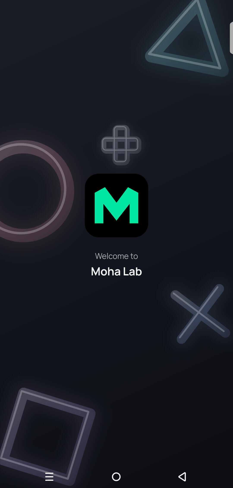
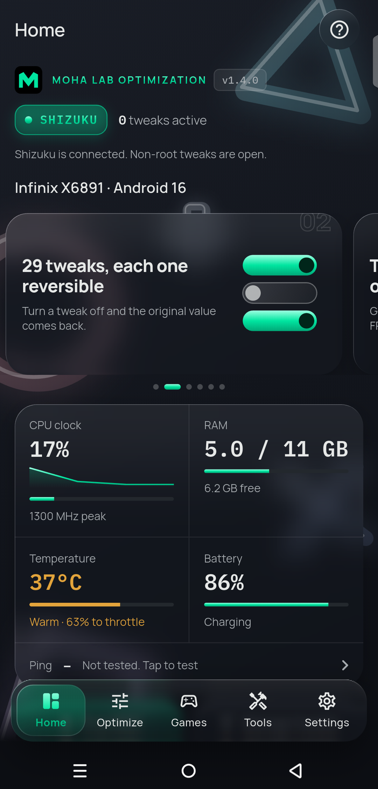
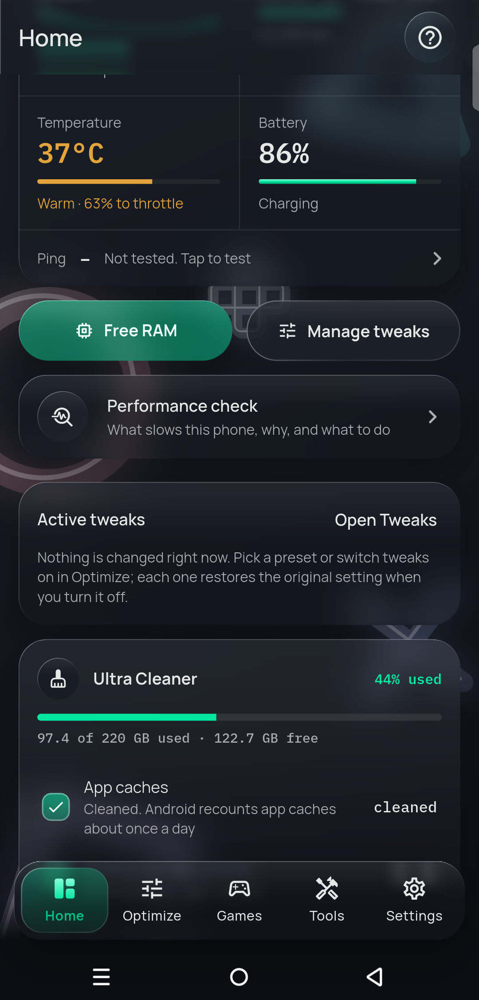

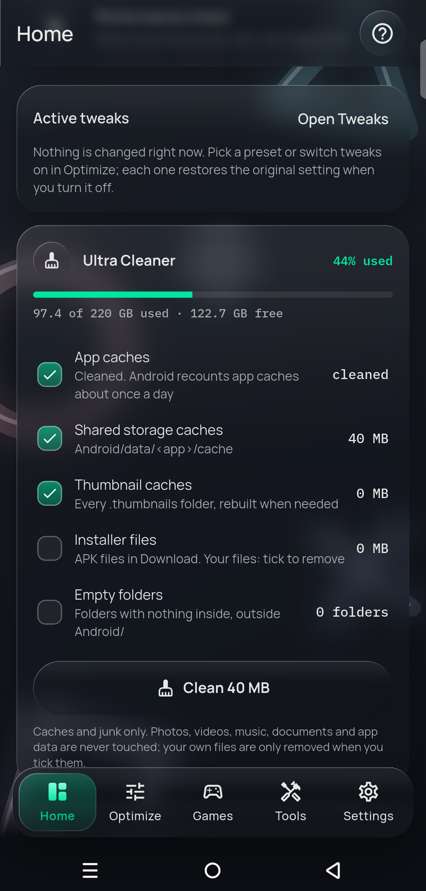
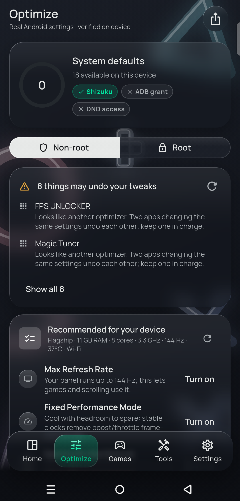
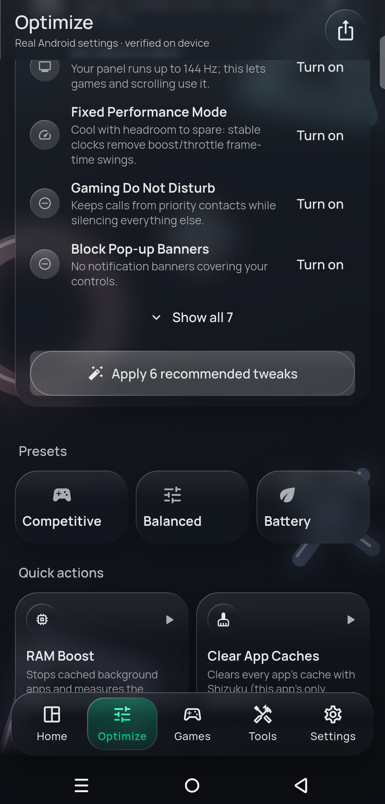

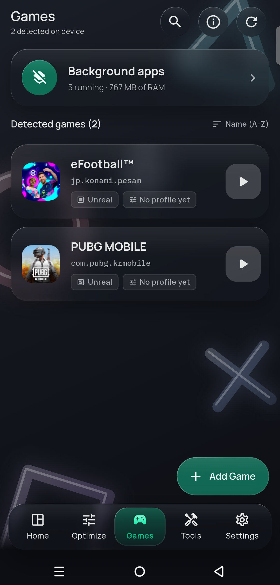
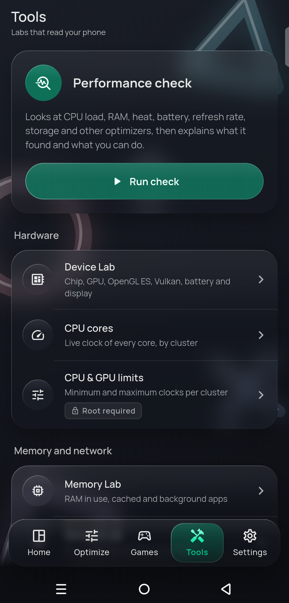
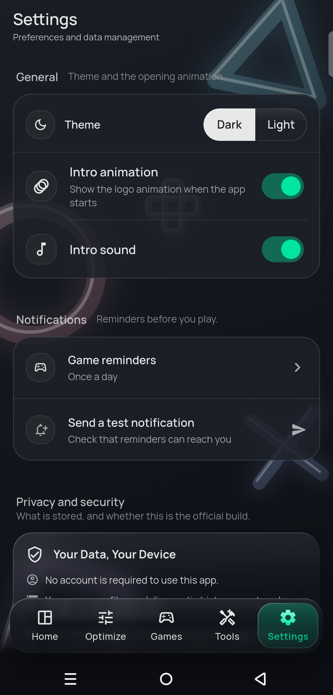

**Root mode** (Magisk, KernelSU, APatch)

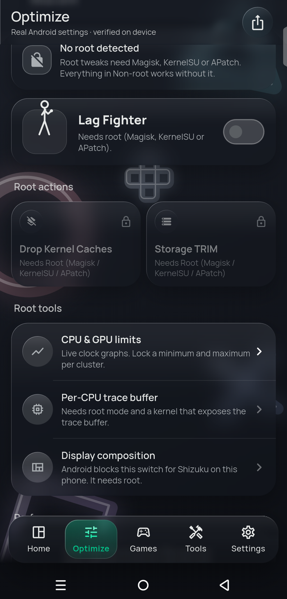
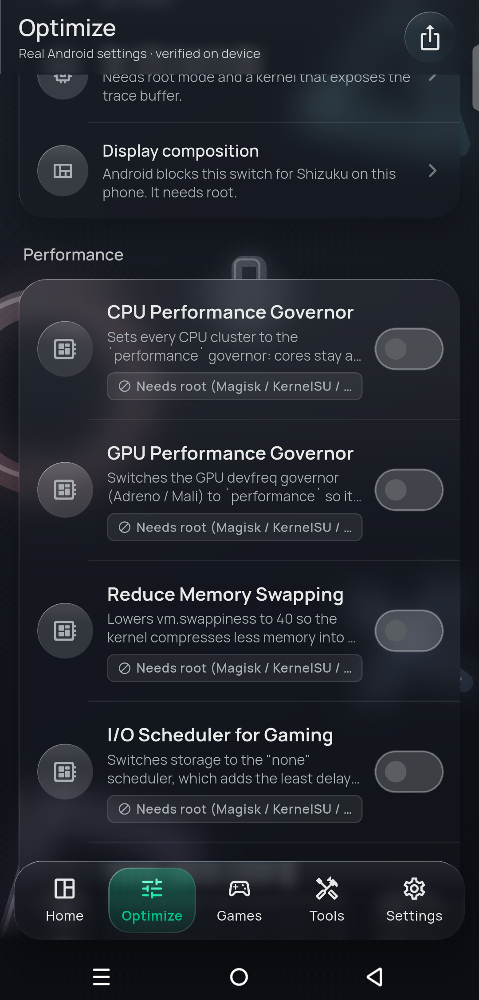
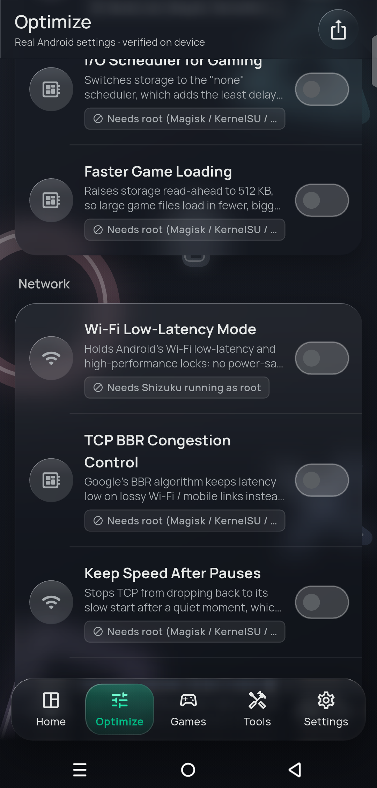
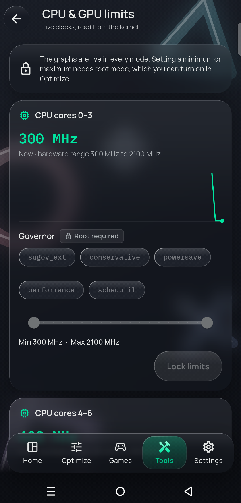

---

## ✨ Features

- **Real tweaks, checked on your phone.** Max refresh rate, faster animations, no window blurs, gaming Do Not Disturb, no pop-up banners, private DNS, faster touch and hold and more. Every tweak is read back after it is applied, and switching it off puts your original setting back.
- **Per-game profiles.** Android's Game Mode, render resolution, frame rate, graphics driver and priority for each game, where Android allows them, plus presets and Focus Launch.
- **MohaLab Boost.** A side panel over your games with live FPS, performance modes, screen recording with game sound, Smart trigger, Net Flash, Do Not Disturb and call blocking.
- **Measured cleaning.** RAM Boost and Ultra Cleaner show what was really freed, never an estimate.
- **Tools.** Device Lab, CPU cores, Touch Claw, touch test, gyro check, Memory Lab, Network Lab and more.
- **Root mode** (Magisk, KernelSU, APatch): CPU and GPU governors and limits, Lag Fighter, network and storage tweaks.
- **Access without root:** through MohaLab Bridge ([github.com/7Mohan/mohalab-bridge](https://github.com/7Mohan/mohalab-bridge)), free from the same developer, or a one-time ADB permission for settings tweaks.
- **9 languages:** English, Indonesian, Portuguese, Filipino, Arabic, Hindi, Malay, Bengali and Vietnamese.

Results depend on the phone and the game. No app can make a phone's chip faster; Moha Lab removes what slows games down.

---

## 🔒 Privacy

- No account, and your data stays on your phone.
- Anonymous usage statistics only, asked for first where the law requires it.
- Full details: [privacy policy](store/privacy-policy.md) · [permissions](PERMISSIONS_AND_PRIVACY.md)

---

## 🌐 Community

- ✈️ **Telegram:** [@Mohagaminglab](https://t.me/Mohagaminglab)
- 🌐 **Website:** [mohagaminglab.vercel.app](https://mohagaminglab.vercel.app/)
- 🎵 **TikTok:** [@professor0011110](https://www.tiktok.com/@professor0011110)
- 🐙 **Developer:** [@7Mohan](https://github.com/7Mohan)

---

## 📄 License

Copyright © 2026 Mohan ([@7Mohan](https://github.com/7Mohan)). All rights reserved.
The app is free to download and use from the official releases. Its source code is not published. See [LICENSE](LICENSE).
